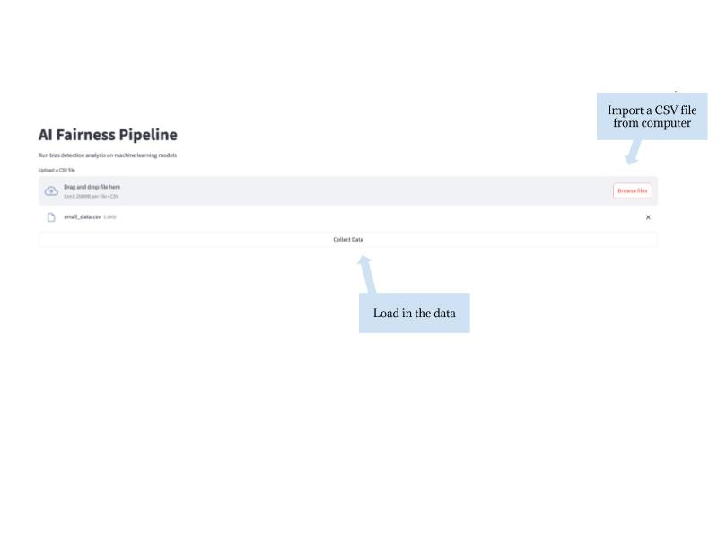
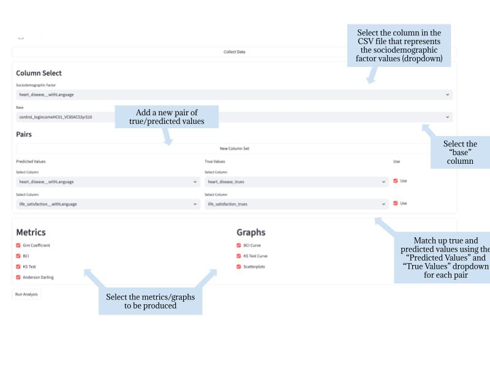
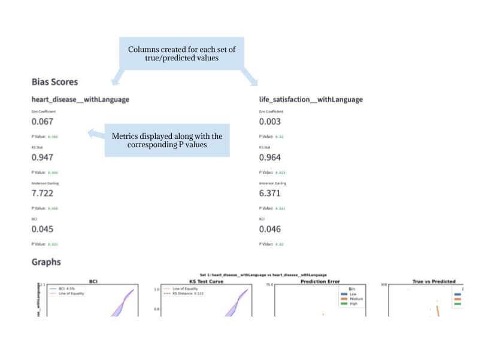
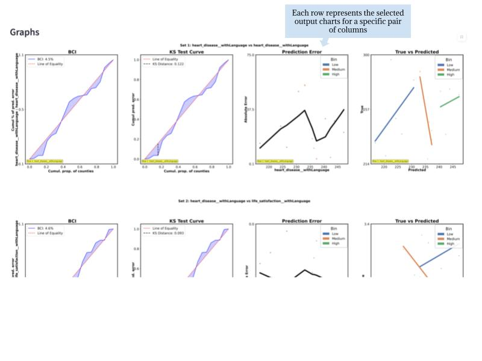

# AI Fairness Pipeline

A web application and research toolkit for measuring **sociodemographic error disparities** in machine learning models, based on the paper *"Quantifying Error Disparities in Population Health Models"* (IJCAI-26, AI and Social Good track).

## Live App

The web app is hosted on Streamlit Community Cloud and allows users to upload their own CSV data and run bias detection analysis without any coding.
https://humanlanguage.org/BCI

## Background

Most AI fairness research evaluates disparities at the individual or document level using discrete demographic categories. This project introduces the **Bilateral Concentration Index (BCI)** — a metric inspired by the Gini coefficient and Concentration Curves — to quantify nonmonotonic error disparities in community-level prediction tasks where sociodemographic attributes are continuous rather than categorical.

The BCI captures disparity magnitude regardless of direction, detecting non-linear relationships between prediction error and sociodemographic rank that are missed by standard metrics like KS statistic or Concentration Index.

The paper applies this toolkit to audit sociodemographic error disparities in lexical- and transformer-based models predicting U.S. county-level health outcomes (heart disease, life satisfaction, fair/poor health, suicide mortality) across three demographic factors (income, education, foreign-born population).

---

## Repository Structure

```
AiFairnessPipeline/
├── app.py                          # Streamlit web application
├── runTests.py                     # Driver for the paper's model-training experiments (DLATK, research use)
├── requirements.txt                # Pinned dependencies for the app and analysis
├── requirements-dev.txt            # Adds pytest for running the tests
├── .devcontainer/                  # GitHub Codespaces / VS Code dev container config
├── src/
│   ├── metrics.py                  # BCI, Concentration Index, KS, Anderson-Darling
│   ├── significance.py             # Bootstrap p-values
│   ├── plots.py                    # Concentration curve, KS curve and scatterplots
│   ├── pipeline.py                 # run_analysis(): data preparation + metrics + plots
│   └── RegAndClassTests.py         # Regression/classification test classes (research use)
├── tests/                          # pytest suite
├── features/
│   └── Regression_CTLB_..._PaperVersion.csv   # County-level model predictions used in the paper
└── static/                         # Formula images and README screenshots
```

---

## File Descriptions

### `app.py`
The Streamlit web interface. Users can:
- Upload a CSV file with prediction data
- Select columns for predicted values, true values, error, and a sociodemographic factor
- Choose which bias metrics and graphs to compute
- Download sample data to test the tool

### `src/` (analysis library)
The analysis code has no dependency on Streamlit and can be used directly:

```python
import pandas as pd
from src.pipeline import run_analysis

df = pd.read_csv("predictions.csv")
results, figures = run_analysis(df, demographic="median_income",
                                pred="predicted", true="true",
                                metrics=["bci", "ci"], graphs=["bci"])
print(results["metrics"]["bci"])  # {'value': ..., 'p_vs_random': ..., 'p_vs_baseline': None}
```

- **`metrics.py`**: `bci` (Bilateral Concentration Index, Eq. 8 of the paper, computed in closed form), `concentration_index`, `ks_statistic`, `anderson_darling`, and `order_errors`, which orders errors by the sociodemographic factor. Every metric takes errors already in that order.
- **`significance.py`**: `bootstrap_p_value`, the paper's significance test against a random ordering or a baseline model.
- **`plots.py`**: the figures, styled as in the paper.
- **`pipeline.py`**: `run_analysis`, which cleans the selected columns and computes only the requested metrics and figures.

### `src/RegAndClassTests.py`
Research-facing classes for running regression and classification experiments using the DLATK framework against a database backend. Used in the original paper's large-scale audit. Not used by the web app.

### `runTests.py`
Driver script that trained the paper's prediction models (CTLB county-level dataset; an earlier DS4UD configuration is also included) using [DLATK](https://github.com/dlatk/dlatk). It requires DLATK and access to the original MySQL databases, which are not public, so it is included for provenance rather than to be run. Not used by the web app.

### `features/`
The county-level predictions produced by `runTests.py` for the paper, which the `src/` analysis code reads.

---

## Web App Usage

### Input Format
Upload a CSV with a header row. You will need columns for:
- **Sociodemographic factor** — a continuous demographic variable (e.g. % with high school diploma, median income)
- **Predicted values** and **true values**, or a single **error** column if you have already computed errors
- **Baseline** *(optional)* — a comparison model's predictions (or its errors, in error-column mode), to test whether your model's disparity is larger

A sample dataset is available to download directly from the app.

### Data Assumptions
- **The sociodemographic factor must be continuous** (e.g. median income, % foreign-born). BCI orders units by this variable, so it needs a meaningful ordering. Binary or categorical attributes (e.g. sex, race) are not supported, and the tercile binning used in the plots will reject them.
- Repeated values (e.g. percentages rounded to 0.1) are fine. Within a group of tied values, units are ordered by error size, which matches how the paper's results were computed.
- Rows with missing or non-numeric values in any selected column are dropped.
- BCI is computed on absolute error, so it captures the *magnitude* of disparity, not its direction.

### Metrics Computed
| Metric | Description |
|--------|-------------|
| **BCI** | Bilateral Concentration Index — primary disparity metric, captures nonlinear relationships |
| **Concentration Index (CI)** | Signed area between the error curve and the line of equality. Positive: error concentrated in units low on the factor; negative: in units high on it. Opposite deviations cancel, which is why it complements BCI |
| **KS Statistic** | Maximum deviation between error curve and line of equality |
| **Anderson-Darling** | Tail-weighted disparity measure |

Each metric gets one-sided bootstrap p-values (1,000 resamples):
- **vs. random ordering**: is the disparity larger than if errors were unrelated to the sociodemographic factor? (The paper's Table 3.)
- **vs. baseline** (when a baseline column is selected): is the disparity larger than the baseline model's? (The paper's Table 4.)

These tests are conservative: p-values tend to be too large rather than too small. `P < 0.001` means no resample reached the observed disparity.

### Graphs
- **BCI Curve** — concentration curve vs. line of equality
- **KS Curve** — KS distance visualization
- **Scatterplots** — prediction error and true vs. predicted values colored by demographic tercile

---

## How to Use

### Step 1: Load Data File


Upload your CSV file using the file uploader. You can also click **Download Sample Data** to get a sample dataset to try the tool with.

### Step 2: Select & Tag Columns and Configure Output Formats


Select the sociodemographic factor and either the predicted and true value columns or a precomputed error column. Optionally compare against a baseline model. Choose which metrics and graphs to compute.

### Step 3: View Output (Metrics)


After clicking **Run Analysis**, bias scores are displayed in a table with each metric's p-values.

### Step 4: View Output (Graphs)


Visualizations are displayed below the metrics table, including the BCI concentration curve, KS test curve, and scatterplots of error and true vs. predicted values colored by demographic tercile.

---

## Installation (Local)

Requires Python 3.11 or newer.

```bash
git clone https://github.com/AaronMarker/AiFairnessPipeline.git
cd AiFairnessPipeline
pip install -r requirements.txt
streamlit run app.py
```

### Running the tests

```bash
pip install -r requirements-dev.txt
pytest
```

---

## Citation

If you use this tool or the BCI metric in your work, please cite:

```
@inproceedings{marker2026quantifying,
  title={Quantifying Error Disparities in Population Health Models},
  author={Marker, Aaron and Giorgi, Salvatore and Ganesan, Adithya V and Varadarajan, Vasudha and Deshpande, Ojas and Brandt, Laura and Odom, Gabriel and Schwartz, H. Andrew},
  booktitle={Proceedings of the Thirty-Fifth International Joint Conference on Artificial Intelligence (IJCAI-26)},
  pages={7346--7354},
  year={2026}
}
```

---

## License

MIT. See [LICENSE](LICENSE).
